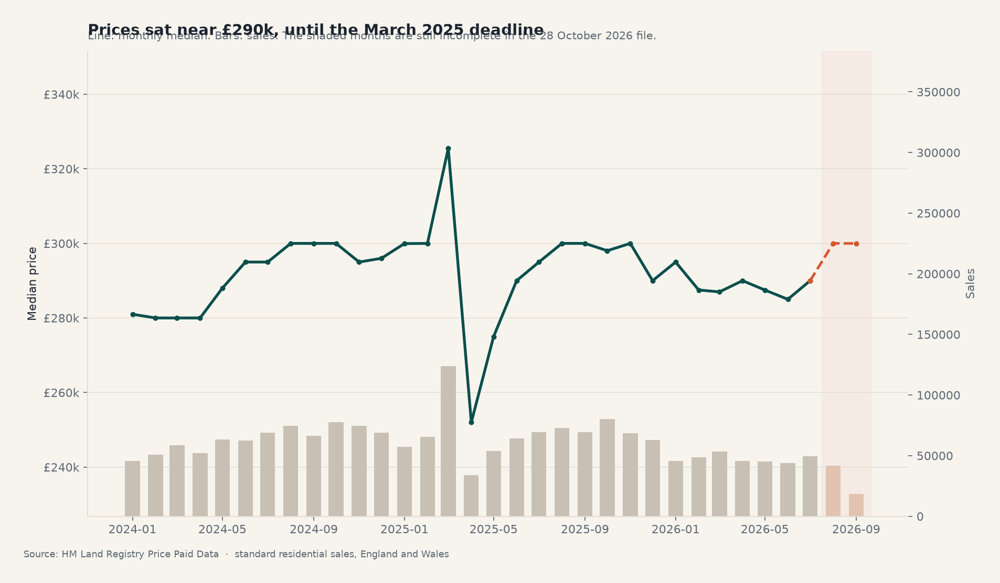
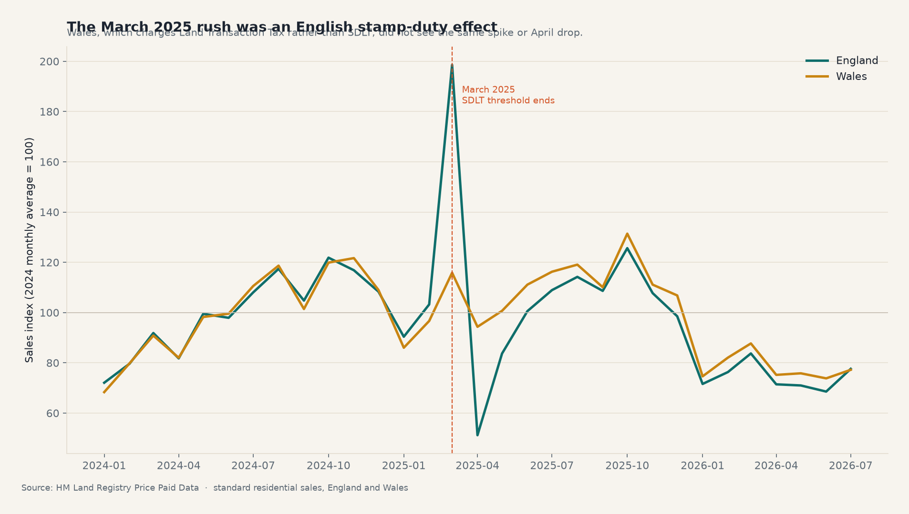
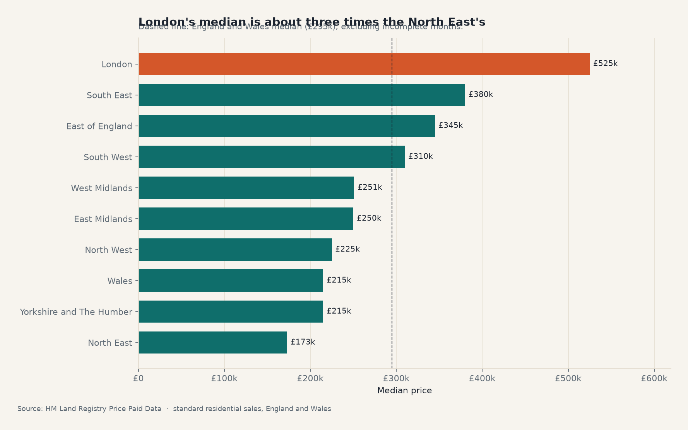
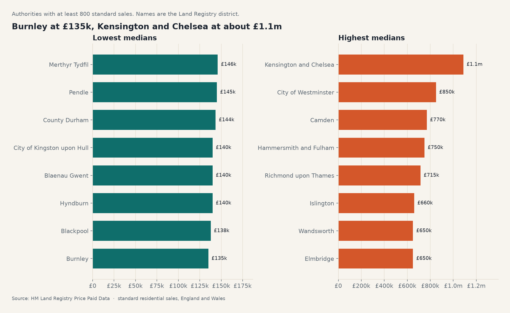
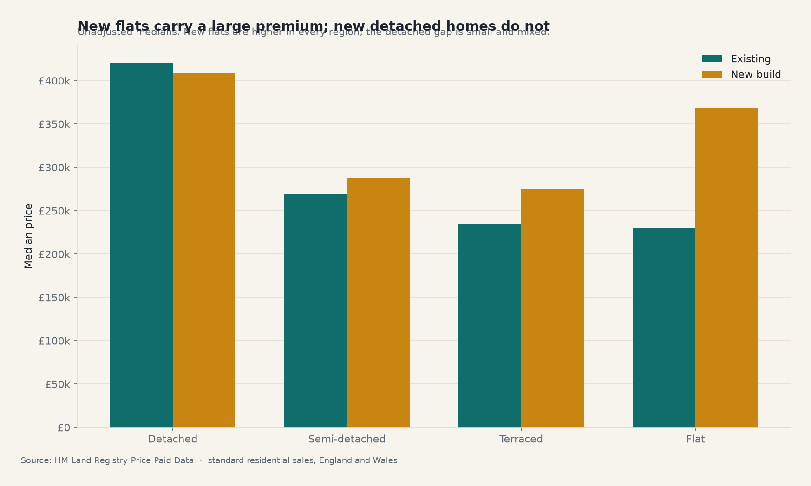
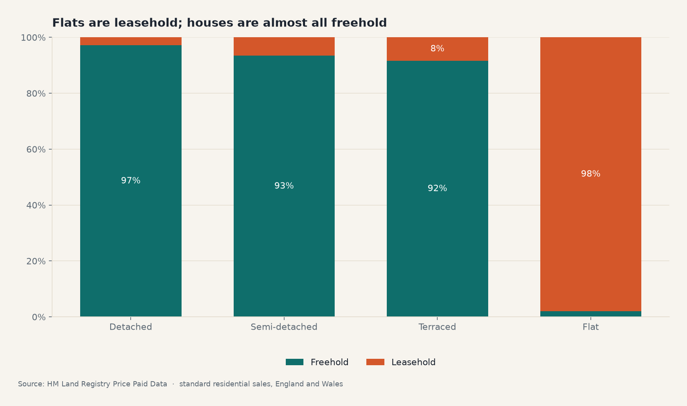
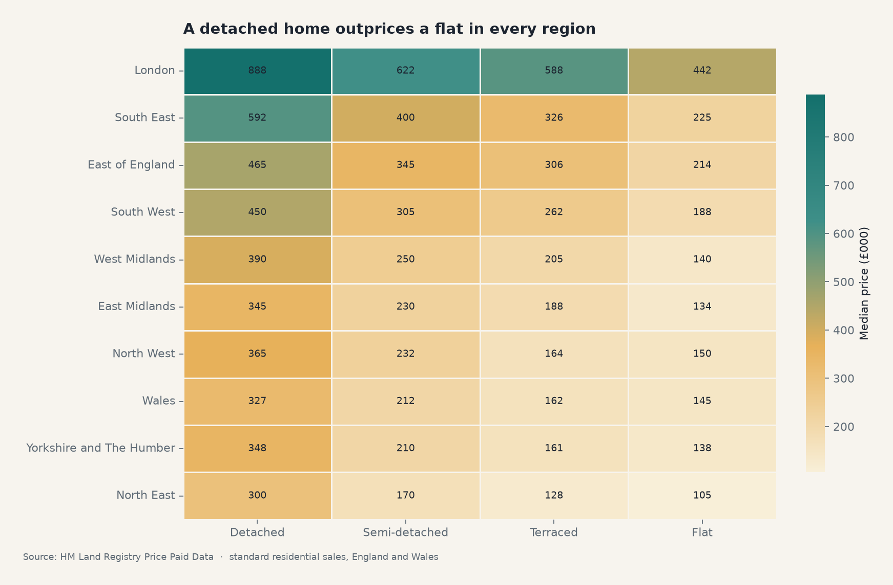
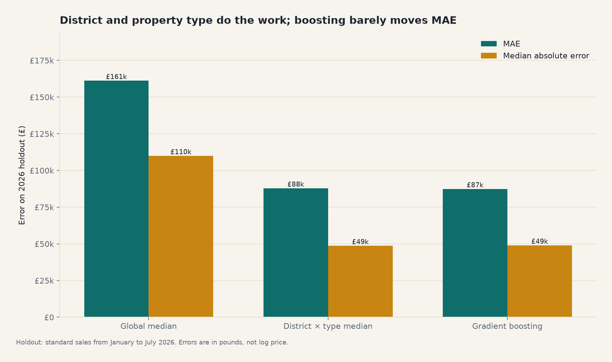
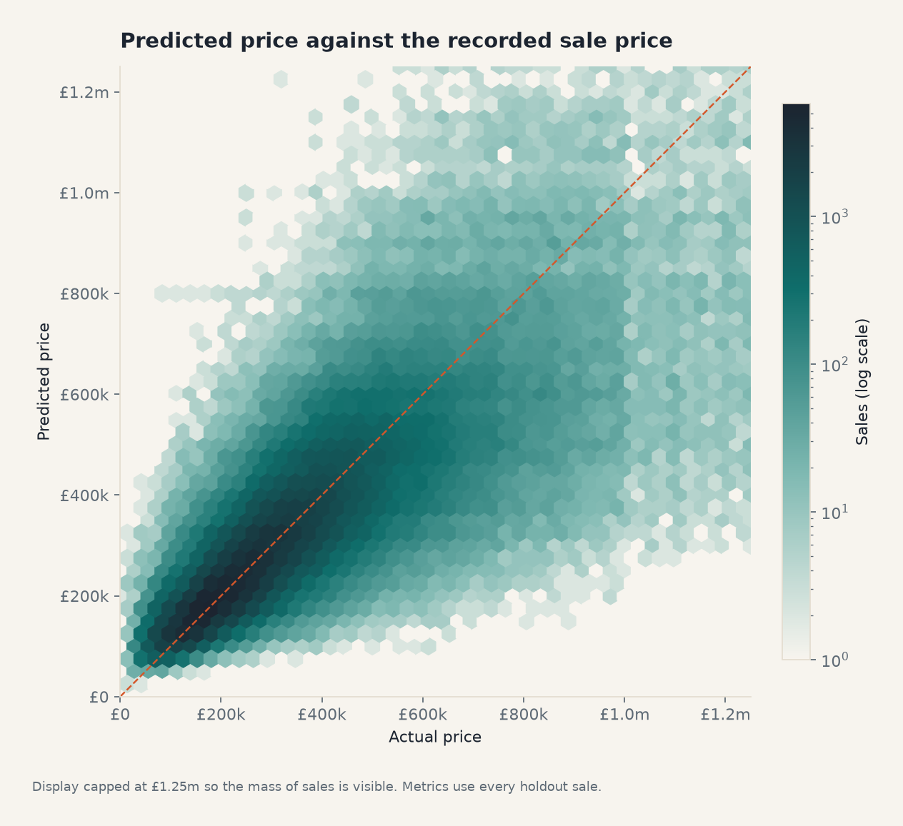
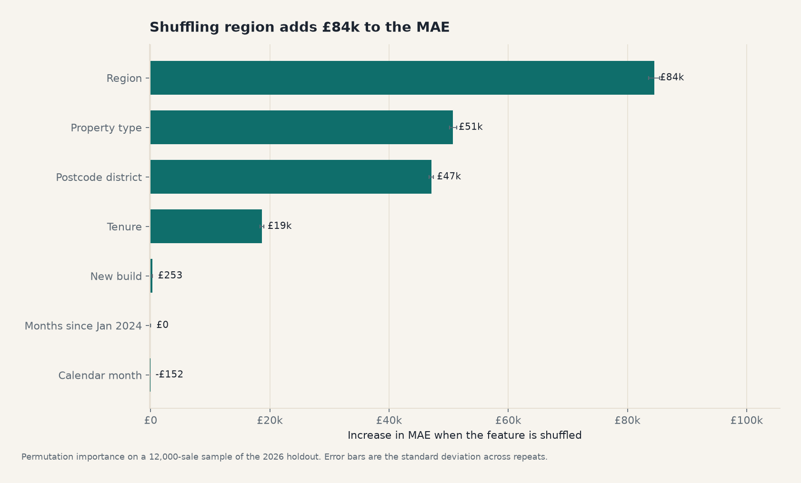

# England and Wales house prices, 2024–2026

What did homes actually sell for, and how much of the next sale can you predict from the public record?

This project analyses [HM Land Registry Price Paid Data](https://www.gov.uk/government/statistical-data-sets/price-paid-data-yearly-file): every residential sale in England and Wales lodged for registration. The extract is the yearly files for 2024, 2025, and 2026 (published 28 October 2026). Scotland and Northern Ireland are not in this register. Raw files are downloaded by a script and are not committed.

The median standard sale from January 2024 to July 2026 was **£295,000**. A postcode district and a property type already predict the next year about as well as gradient boosting. The interesting movement in the series is not a smooth price trend. It is the English stamp-duty deadline of 31 March 2025.



## Findings

Numbers below are from the executed notebooks in this repository. Complete months are January 2024 through July 2026. August and September 2026 are still being registered (the file was published on 28 October 2026) and are shaded on the time chart. They are excluded from the medians and from the model test.

**The market was quiet, then one month was not.** The monthly median opened at £281,000 in January 2024 and was £290,000 in July 2026. It spent most of the period near £290,000–£300,000. March 2025 broke that pattern: 123,716 standard sales and a median of £325,500, then April fell to 33,982 sales and a median of £252,000.

**That break is an English tax deadline, visible because Wales did not move with it.** On 1 April 2025 the residential stamp duty nil-rate band in England reverted from £250,000 to £125,000. Wales charges Land Transaction Tax, which did not change on that date. Indexed to each nation's own 2024 monthly average, English sales hit **199** in March 2025 and **51** in April. Wales was **116** and **94**. England's median went from £302,500 in February to £330,000 in March and £257,000 in April. The Welsh median stayed at £210,000, then £220,000, then £220,000. In England, the share of sales under £250,000 fell from 36% in February to 30% in March, then rose to 47.5% in April: the deadline pulled forward higher-value completions.



**Place dominates the cross-section.** London's median is £525,000, about three times the North East (£173,000). The South East is next at £380,000. Among local authorities with at least 800 sales, Burnley is £135,000 and Kensington and Chelsea is £1.09 million.





**Type, tenure, and new build are the other splits the file supports.** There is no floor area, bedroom count, or condition.

| Property type | Median | Share of sales |
| --- | ---: | ---: |
| Detached | £419,995 | 26% |
| Semi-detached | £271,000 | 30% |
| Flat | £240,000 | 17% |
| Terraced | £237,500 | 27% |

Semi-detached homes are the most common sale. Detached homes are the most expensive in every region: £888,000 in London, £300,000 in the North East. A flat in the North East has a median of £105,000.

New builds are 6.7% of sales. A new flat's median is £369,000, against £230,000 for an existing flat (+60%), and that premium appears in all ten regions. New detached homes (£408,000) sit slightly below existing detached homes (£420,000). Within regions that detached gap is small and changes sign, which fits new estates sitting in different places from the existing detached stock.

Flats are 98% leasehold. Houses are almost all freehold: 97% of detached, 93% of semi-detached, and 92% of terraced sales.







## Predicting 2026

The test is every standard sale from January to July 2026 (331,973 sales). Training is January 2024 to December 2025 (1,586,030 sales). October–December 2025 are used only to choose the number of trees (430); the model is then refit on the whole training window. More than 99.9% of test sales have a district and property type already seen in training.

The booster is LightGBM, trained on log price, with metrics reported in pounds. Postcode district has a few thousand levels. scikit-learn's histogram gradient boosting only accepts categorical features with up to 255 levels, so it cannot take district as a category. Features are property type, new build, tenure, region, postcode district, calendar month, and months since January 2024.

| Model | MAE | Median absolute error | RMSE | R² |
| --- | ---: | ---: | ---: | ---: |
| Training median, every sale | £161,221 | £110,000 | £277,071 | −0.05 |
| Training median by district and property type | £87,947 | £48,750 | £170,681 | 0.60 |
| Gradient boosting | £87,454 | £49,061 | £168,756 | 0.61 |

The grouped median does the work. Gradient boosting improves MAE by £493 and makes the typical error slightly worse (£49,061 against £48,750). The national median's R² is negative because squared error is scored against the test-set mean, and prices are skewed. Mean absolute error is the metric that matches the decision.

On the holdout, the median absolute error is 15–22% of the local median price: 15% in the East of England, 22% in the North East. London's typical miss is £95,000, about 19% of the London level. Permutation importance is dominated by region, property type, and postcode district. Those location features are nested, so the pound figures are not additive. Tenure still adds about £19,000 of MAE when shuffled. The time trend and calendar month are within noise, which matches a market whose median barely moved once the stamp-duty month is set aside.







This is not a valuation. The residual is tens of thousands of pounds because the file does not describe the building. Category B sales (repossessions, some buy-to-lets, corporate buyers, non-standard property) are excluded on purpose.

## Reproduce

Python 3.10 or newer. The yearly files are about 400 MB in total.

```bash
python3 -m pip install -r requirements.txt
export PYTHONPATH=src
python3 -m house_prices.download    # data/raw/pp-2024.csv, pp-2025.csv, pp-2026.csv
python3 -m house_prices.prepare     # data/processed/transactions.parquet and a 4,000-row sample
python3 -m pytest
python3 -m nbconvert --to notebook --execute --inplace notebooks/01_exploratory_analysis.ipynb
python3 -m nbconvert --to notebook --execute --inplace notebooks/02_price_prediction.ipynb
```

`make install download prepare test notebooks` runs the same steps. The notebooks also build the parquet if it is missing. A cleaned 4,000-row sample is committed at `data/sample/price_paid_sample.csv` so the column layout can be inspected without the download. The published notebook outputs were produced from the full extract, not the sample.

## How the table is built

`house_prices.clean` keeps standard residential sales only:

- Price Paid category A. Category B is a different mix of transactions, and in this extract every property typed "other" is already in category B.
- Prices from £10,000 to £5,000,000 (1,119 rows dropped).
- County mapped to an English region or to Wales. The map covers all 113 county names in these files; unmatched counties would be kept as "Unknown" and there were none.

Of 2,382,455 rows in the three yearly files, 402,983 were category B and 1,978,353 remain. The yearly files are collated on the transfer date, unlike the monthly change files. The two most recent months are incomplete because registration lags completion, usually by two weeks to two months.

## Project structure

```
src/house_prices/     download, cleaning, region map, model, charts
notebooks/            exploratory analysis and the 2026 prediction
tests/                cleaning rules, the county map, the time split and baselines
reports/figures/      charts embedded above
reports/*.json        cleaning counts and the metrics from this run
data/raw/             downloaded yearly CSVs (gitignored)
data/processed/       analysis parquet (gitignored)
data/sample/          4,000 cleaned rows, committed
```

## Data licence

Contains HM Land Registry data © Crown copyright and database right 2026. This data is licensed under the [Open Government Licence v3.0](https://www.nationalarchives.gov.uk/doc/open-government-licence/version/3/).

Column definitions and the category A / category B distinction are documented in [About the Price Paid Data](https://www.gov.uk/guidance/about-the-price-paid-data). The code in this repository is MIT licensed. The MIT licence does not apply to the Price Paid Data.
